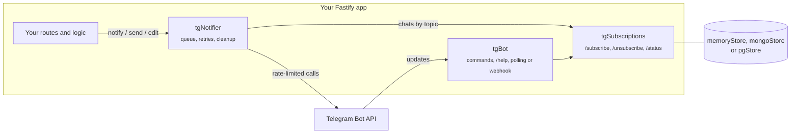

<div align="center">

# @dirai-kit/tg

Fastify plugins for Telegram bots on [grammY](https://grammy.dev).
Commands with access control, chat subscriptions, rate-limited broadcasts and live messages, in a few lines.

[](https://www.npmjs.com/package/@dirai-kit/tg)
[](https://github.com/DiRaiks/dirai-kit/actions/workflows/ci.yml)
[](https://www.npmjs.com/package/@dirai-kit/tg#provenance)
[](package.json)
[](LICENSE)

</div>

> Formerly `@dirai/tg-kit`: 1.5.0 is the same code under the new name. Replace the dependency and the imports, nothing else changes.

Most bots repeat the same plumbing: `/start` and `/help`, a list of chats to notify, broadcasting without hitting Telegram limits, cleaning up chats that blocked the bot, switching between polling and webhooks. This kit packs that into three Fastify plugins, so a new bot is mostly its own logic.

## Features

- **Commands with scopes.** Everyone, bot admins, or admins of the group (anonymous admins and channels included). `/help` and the Telegram command menu are generated.
- **Texts per language.** Replies, `/help` and the command menu in the chat's language, with a fallback for the rest.
- **Subscriptions.** `/subscribe`, `/unsubscribe`, `/status` per topic, stored in memory, MongoDB or Postgres, with per-chat settings.
- **Broadcasts that behave.** One queue under Telegram's rate limits, automatic retries on 429, chats that blocked the bot are unsubscribed, groups upgraded to supergroups are followed.
- **Live messages.** Send, pin, edit and unpin, plus silent sends, to keep a status message up to date while short updates go out quietly.
- **Safe HTML.** A template tag that escapes everything you interpolate.
- **Polling, webhook or none.** Webhooks check Telegram's secret token; `none` is for tests and send-only bots.
- **Health and metrics.** A health report with webhook errors from Telegram, and Prometheus counters for updates, commands and deliveries.
- **Testable.** Plug in a fake Telegram API and feed updates directly.

## Install

```bash
npm install @dirai-kit/tg grammy fastify
```

Requires Node.js 24+ and Fastify 5.

## Quick start

```ts
import Fastify from 'fastify';
import { html, memoryStore, tgBot, tgNotifier, tgSubscriptions } from '@dirai-kit/tg';

const app = Fastify({ logger: true });

await app.register(tgBot, { token: process.env.BOT_TOKEN!, mode: 'polling' });
await app.register(tgSubscriptions, { store: memoryStore(), topics: ['releases'] });
await app.register(tgNotifier);

app.tg.command({
  command: 'ping',
  description: 'Check that the bot is alive',
  handler: (ctx) => ctx.reply('pong'),
});

// POST /announce sends a pinned message to every chat subscribed to "releases"
app.post('/announce', async () =>
  app.notifier.notify('releases', html`<b>${'v2.0'}</b> is out`, { pin: true }),
);

await app.listen({ port: 3000 });
```

Add the bot to a chat, send `/subscribe`, then `curl -X POST localhost:3000/announce`.

A complete bot with an admin command, a protected HTTP endpoint and health checks is in [`examples/minimal-bot`](examples/minimal-bot/index.ts):

```bash
BOT_TOKEN=123:abc ANNOUNCE_KEY=secret npx tsx examples/minimal-bot/index.ts
```

## Start a new bot

The [`template`](../../template) is a complete bot to copy: config from the environment, commands, subscriptions in MongoDB, an announce endpoint, health checks, metrics, tests and a Dockerfile.

```bash
npx degit DiRaiks/dirai-kit/template my-bot
cd my-bot && npm install && cp .env.example .env   # set BOT_TOKEN
npm run dev
```

CI checks the template against every change of the kit.

## How it fits together



## Recipe: a live status message

Pin one message and keep it current; send short notes without a sound. This is how [football-planner](https://github.com/DiRaiks/football-planner) keeps a match roster in team chats.

```ts
// When the match is created: pin an announcement and remember where it went
const { messages } = await app.notifier.notify('events', announcement(match), { pin: true });
await saveAnnouncements(match.id, messages); // [{ chatId, messageId }, ...]

// On every sign-up: refresh the pinned message, then a quiet note
for (const target of await loadAnnouncements(match.id)) {
  await app.notifier.edit(target, announcement(match));
}
await app.notifier.notify('events', html`✅ <b>${player.name}</b> is in · 8/10`, { silent: true });
```

The chat sees one message that changes, not a stream:

```text
⚽ Tuesday game
📅 Tue, 27 Oct · 20:00
📍 Dynamo stadium, pitch 2

👥 8 of 10  ▰▰▰▰▰▰▰▰▱▱
✅ Sure: Ildar, Artem, Maria, Timur, …
Two more needed                                    [ Sign up ]
```

## Plugins

### `tgBot`

Creates the grammY bot as `app.tg.bot`, retries on rate limits and logs failed updates.

| Option         | Description                                                                                                                                                                                               |
| -------------- | --------------------------------------------------------------------------------------------------------------------------------------------------------------------------------------------------------- |
| `token`        | Bot token from [@BotFather](https://t.me/BotFather)                                                                                                                                                       |
| `mode`         | `polling` (default), `webhook`, or `none` (tests, send-only bots)                                                                                                                                         |
| `webhook`      | `{ url, secretToken, path? }`. HTTPS base URL (a path prefix is kept); updates arrive at `path` (default `/telegram/webhook`) and must carry the secret token                                             |
| `admins`       | Telegram user ids allowed to run `admin` commands                                                                                                                                                         |
| `botInfo`      | Skips `getMe`, for tests                                                                                                                                                                                  |
| `configureApi` | Extra API transformers, e.g. a fake API in tests                                                                                                                                                          |
| `texts`        | Overrides for the `/start` reply, the `/help` title, the "forbidden" reply, and the command descriptions (`helpDescription`; `startDescription` only shows in `app.tg.commands()`, as `/start` is hidden) |
| `language`     | `(ctx) => code \| undefined`, sync or async: the update's language, e.g. one the chat chose in settings. Defaults to the user's Telegram language                                                         |

```ts
app.tg.command({ command, description, scope, hidden, handler });
```

| Scope       | Who can run it                                                                        |
| ----------- | ------------------------------------------------------------------------------------- |
| `all`       | Everyone (default)                                                                    |
| `admin`     | User ids from `admins`                                                                |
| `chatAdmin` | Anyone in a private chat; in groups only admins (anonymous admins too); channel posts |

`app.tg.text(value, ctx)` resolves a `Localized` value in the update's language, and `app.tg.language(ctx)` returns that language.

#### Languages

Every text and command description takes either one value or one per language. Keys are Telegram language codes; `default` serves the rest. `default` is required; keys match in any case. A reply looks up its language, then the base language (`pt` for `pt-br`), then `default`. The language is resolved once per update, so a command that changes it answers in the old one; if the resolver throws, the update gets the default texts.

```ts
await app.register(tgBot, {
  token,
  texts: {
    start: { default: 'Hi! Commands: /help', ru: 'Привет! Команды: /help' },
    helpDescription: { default: 'List commands', ru: 'Список команд' },
  },
  // Optional: a language the chat chose instead of the user's Telegram one
  language: async (ctx) => (await settingsOf(ctx.chat?.id))?.language,
});

app.tg.command({
  command: 'watch',
  description: { default: 'Watch an address', ru: 'Следить за адресом' },
  handler: async (ctx) =>
    ctx.reply(await app.tg.text({ default: 'Send an address', ru: 'Пришлите адрес' }, ctx)),
});
```

The menu is set once for everyone and once per two-letter language some description has (`ru` above). Telegram picks it by the user's app language, so a language from the `language` option shows in replies and `/help`, not in the menu. Commands without a translation keep their default description in a language's menu. A menu Telegram rejects is logged and the rest are still set. Dropping a language later leaves its old menu in Telegram: remove it once with `bot.api.deleteMyCommands({ language_code })`.

On `ready` the plugin sets the command menu and starts polling or registers the webhook. A Telegram outage at startup is logged and does not stop the server. On `close` polling stops.

### `tgSubscriptions`

Adds `/subscribe [topic]`, `/unsubscribe [topic]` (both `chatAdmin`) and `/status`. Without a topic, `/subscribe` takes every topic and `/unsubscribe` removes the chat. The same operations are available in code as `app.subscriptions`.

`texts` overrides the replies (`subscribed`, `unsubscribed`, `unknownTopic`, `status`) and the command descriptions (`subscribeDescription`, `unsubscribeDescription`, `statusDescription`); the defaults are in Russian. Each takes one value per language too, the reply functions included: `subscribed: { default: (topics) => ..., ru: (topics) => ... }`.

| Store                                      | Use                                                                                                                                                                                                                                                                                                |
| ------------------------------------------ | -------------------------------------------------------------------------------------------------------------------------------------------------------------------------------------------------------------------------------------------------------------------------------------------------- |
| `memoryStore()`                            | Tests and throwaway bots                                                                                                                                                                                                                                                                           |
| `mongoStore(collection, { legacyTopics })` | Any MongoDB collection (driver or `mongoose.connection.collection(...)`). Documents are `{ chatId, topics, settings }`; documents without `topics` count as subscribed to `legacyTopics`, so a bot can adopt an existing `chats` collection                                                        |
| `pgStore(client, { table })`               | Any Postgres client with `query(text, values)`: a `pg` Pool or Client, or PGlite. Chats live in `table` (default `tg_chats`, `schema.table` works) with `chat_id` bigint, `topics` text[] (GIN index) and `settings` jsonb; the table is created on first use. The kit does not depend on a driver |

`settings` holds free-form per-chat data, such as watched addresses.

### `tgNotifier`

| Method                                          | Description                                                                                    |
| ----------------------------------------------- | ---------------------------------------------------------------------------------------------- |
| `notify(topic, message, options)`               | Sends to every chat subscribed to `topic`; resolves with `{ sent, failed, removed, messages }` |
| `send(chatId, message, options)`                | Sends to one chat; resolves with `{ chatId, messageId }` or `null`                             |
| `edit({ chatId, messageId }, message, options)` | Replaces the text; "message is not modified" counts as success                                 |
| `unpin({ chatId, messageId })`                  | Unpins a message                                                                               |

Options: `pin`, `silent`, `replyMarkup` (inline keyboard), `disablePreview` (default `true`).

All calls share one queue spaced by `minIntervalMs` (default 40 ms, under Telegram's ~30 messages per second). Chats where the bot was blocked or removed are unsubscribed, and a store failure while doing so never breaks the broadcast. Pinning without admin rights is logged and does not fail the message.

### `html`

```ts
html`<b>${userInput}</b>`;           // interpolations are escaped
html`${html`<i>nested</i>`}`;        // nested templates stay markup
raw('<a href="…">trusted</a>');      // inserted as is
joinHtml([title, maybeLine, footer]); // skips null, undefined and false; joins with \n
```

### `tgHealth`

```ts
await app.register(tgHealth); // GET /telegram/health and GET /metrics
```

The health report answers 503 when the bot cannot get updates: polling stopped, no webhook set, Telegram failing to deliver to the webhook in the last 10 minutes while updates wait, or the subscription store not answering. Telegram is asked at most every 30 seconds, and every check gives up after 5 seconds.

```json
{
  "ok": true,
  "mode": "webhook",
  "username": "my_bot",
  "polling": null,
  "webhook": { "set": true, "host": "bot.example.com", "pendingUpdates": 0, "lastError": null, "lastErrorAt": null },
  "store": "ok",
  "queue": 0
}
```

The report shows the webhook's host, not its URL, so a secret path does not leak. Both routes are open by default; pass `onRequest` to protect them, or keep them off the public proxy.

| Option             | Description                                                                                   |
| ------------------ | --------------------------------------------------------------------------------------------- |
| `healthPath`       | Route of the report (default `/telegram/health`), `false` to skip                             |
| `metricsPath`      | Route of the Prometheus metrics (default `/metrics`), `false` to skip                         |
| `registry`         | A [Prometheus client](https://github.com/prometheus/client_js) registry to add the metrics to |
| `prefix`           | Metric name prefix (default `tg_`)                                                            |
| `onRequest`        | A Fastify hook run before both routes, e.g. a token check                                     |
| `webhookInfoTtlMs` | How long Telegram's webhook report is reused (default 30 s)                                   |
| `timeoutMs`        | Longest wait for Telegram or the store (default 5 s)                                          |

Metrics come from the optional `@prometheus-io/client` (`npm install @prometheus-io/client`; it used to be `prom-client`): `tg_updates_total`, `tg_update_errors_total`, `tg_commands_total{command,allowed}`, `tg_messages_total{status}` (sent, failed, removed) and `tg_notifier_queue`. Without the package the plugin logs a warning and serves the report only. An app with its own metrics passes its registry and `metricsPath: false`; several apps may share one registry. An app with its own `/health` calls `app.tgHealth.check()` and sets `healthPath: false`.

`app.tg.events` reports `update`, `command`, `failure` and `delivery` for your own instrumentation; a listener that throws is logged and does not affect the bot.

`safeEmit(app.tg.events, app.log, name, ...args)` emits one of these events the same way: a listener that throws is logged as a warning and the call returns normally. Use it to report events from your own code, e.g. `safeEmit(app.tg.events, app.log, 'delivery', { status: 'sent' })` after a message you send through `app.tg.bot.api`.

## Webhooks in production

```ts
await app.register(tgBot, {
  token: process.env.BOT_TOKEN!,
  mode: 'webhook',
  webhook: { url: 'https://bot.example.com', secretToken: process.env.WEBHOOK_SECRET! },
});
```

Put the app behind a TLS-terminating proxy and route only `/telegram/webhook` to it, so `/telegram/health` and `/metrics` stay private. With Caddy:

```caddyfile
bot.example.com {
	reverse_proxy /telegram/webhook app:3000
}
```

## Testing your bot

Run the bot with `mode: 'none'`, give it `botInfo`, replace the Telegram API, and feed updates:

```ts
const calls: { method: string; payload: unknown }[] = [];

await app.register(tgBot, {
  token: 'test',
  mode: 'none',
  botInfo: { id: 1, is_bot: true, first_name: 'Bot', username: 'test_bot' /* … */ },
  configureApi: (api) =>
    api.config.use(async (_prev, method, payload) => {
      calls.push({ method, payload });
      return { ok: true, result: true } as never;
    }),
});

await app.tg.bot.handleUpdate(update); // e.g. a message with "/subscribe"
expect(calls.at(-1)).toMatchObject({ method: 'sendMessage' });
```

See [`test/helpers.ts`](test/helpers.ts) for a complete fake API and update builders.

## Releasing

Part of the [dirai-kit](https://github.com/DiRaiks/dirai-kit) monorepo; releases are automatic from Conventional Commits, see its README.

## License

[MIT](LICENSE)
